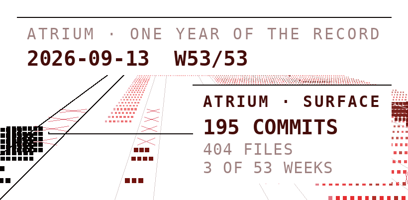
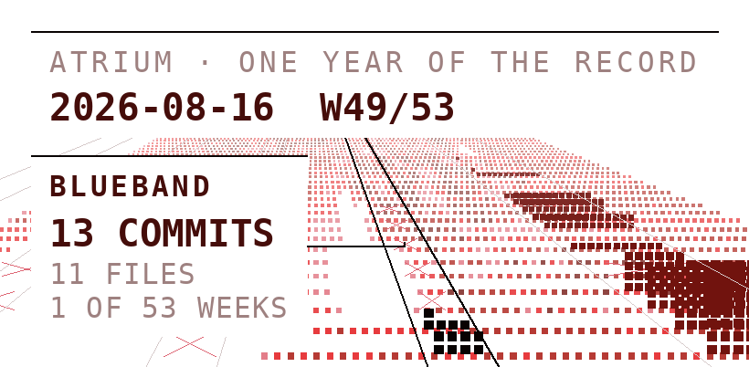
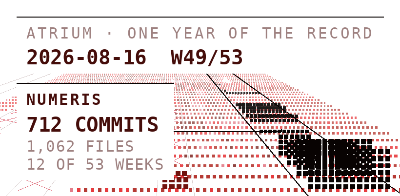

<a href="https://thomasvp.com">
<picture>
  <source media="(prefers-color-scheme: dark)" srcset="https://raw.githubusercontent.com/thomasvanpul/thomasvanpul/main/assets/atrium-dark.4f9b69f.png">
  
</picture>
</a>

# Thomas van Pul

MEng Design Engineering at Imperial College London. I build instruments, then use them.

[thomasvp.com](https://thomasvp.com) &nbsp;·&nbsp; [linkedin.com/in/vanpulthomas](https://www.linkedin.com/in/vanpulthomas) &nbsp;·&nbsp; `vanpulthomas@gmail.com`

Most recent push to a featured public repo: <a href="https://github.com/thomasvanpul/Finance-Tracker">Finance-Tracker</a>, 2026-08-18. Updated daily by a GitHub Action.

<b>BlueBand</b> &nbsp;·&nbsp; a modular sports wristband, in development

<a href="https://www.thomasvp.com/work/blueband">
<picture>
  <source media="(prefers-color-scheme: dark)" srcset="https://raw.githubusercontent.com/thomasvanpul/thomasvanpul/main/assets/blueband-dark.ffb4e86.png">
  
</picture>
</a>

Created at the upLYFT Wearable Tech Hackathon at Imperial in March 2026, where our team placed second.

After the hackathon I designed and routed its two-layer ESP32-S3 board in KiCad and had it custom printed, built the enclosure in CadQuery, and built the site. The team is working towards a launch.

Case page: [thomasvp.com/work/blueband](https://www.thomasvp.com/work/blueband)

Repo: [thomasvanpul/blueband-concept](https://github.com/thomasvanpul/blueband-concept): concept model and the render pipeline. Board and enclosure files are private.

<b>Numeris</b> &nbsp;·&nbsp; a portfolio tracker, in daily use

<a href="https://www.thomasvp.com/work/numeris">
<picture>
  <source media="(prefers-color-scheme: dark)" srcset="https://raw.githubusercontent.com/thomasvanpul/thomasvanpul/main/assets/numeris-dark.183df35.png">
  
</picture>
</a>

A full-stack build: React, Node.js and PostgreSQL on Vercel, with Plaid for bank connections and Yahoo Finance for market data.

Daily use is where the real problems came from: latency, API rate limits, dirty data and cache invalidation.

Case page: [thomasvp.com/work/numeris](https://www.thomasvp.com/work/numeris)

Repo: [thomasvanpul/Finance-Tracker](https://github.com/thomasvanpul/Finance-Tracker)

<b>Project Svarog</b> &nbsp;·&nbsp; Imperial College Space Society's satellite project

I designed and 3D-printed the moulds for four carbon-fibre booms, each over two metres long, and designed carbon-fibre-reinforced doors.

Case page: [thomasvp.com/work/svarog](https://www.thomasvp.com/work/svarog)

Society project; no public repo.

<b>Also</b> &nbsp;·&nbsp; two smaller things

- **Interstellar Sanctuary**: a Peninsular Malaysia property-launch map, built with an EdgeProp collaborator, July to September 2026. [Password-gated](https://interstellarsanctuary.com).
- **UROP**: with Dr Nan Li at the Dyson School since August 2026, on Hot Form Quench forming across aluminium, steel, titanium and fibre metal laminates.

<b>Stack</b> &nbsp;·&nbsp; what I build with

| | |
| --- | --- |
| Software | Python · JavaScript · SQL · React · Node.js · PostgreSQL · MATLAB |
| Simulation & CAD | Fusion 360 · Ansys FEA · SimScale CFD · KiCad · CadQuery |
| Workshop | TIG welding · 3D printing · composite tooling |

