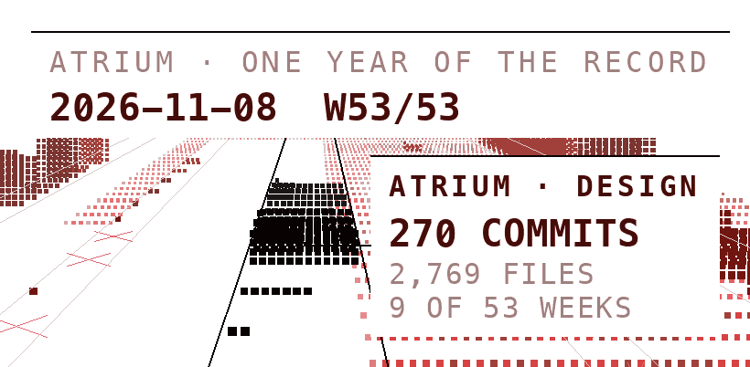

<picture>
  <source media="(prefers-reduced-motion: reduce) and (prefers-color-scheme: dark)" srcset="https://raw.githubusercontent.com/thomasvanpul/thomasvanpul/main/assets/still-dark.fcb4c5a.png">
  <source media="(prefers-reduced-motion: reduce)" srcset="https://raw.githubusercontent.com/thomasvanpul/thomasvanpul/main/assets/still-light.7b6d857.png">
  <source media="(prefers-color-scheme: dark)" srcset="https://raw.githubusercontent.com/thomasvanpul/thomasvanpul/main/assets/anim-dark.30e25e8.gif">
  
</picture>

# Thomas van Pul

Design Engineering at Imperial College London.

[thomasvp.com](https://thomasvp.com) &nbsp;·&nbsp; [linkedin.com/in/vanpulthomas](https://www.linkedin.com/in/vanpulthomas)
